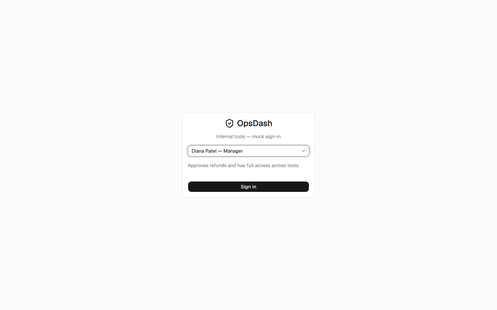
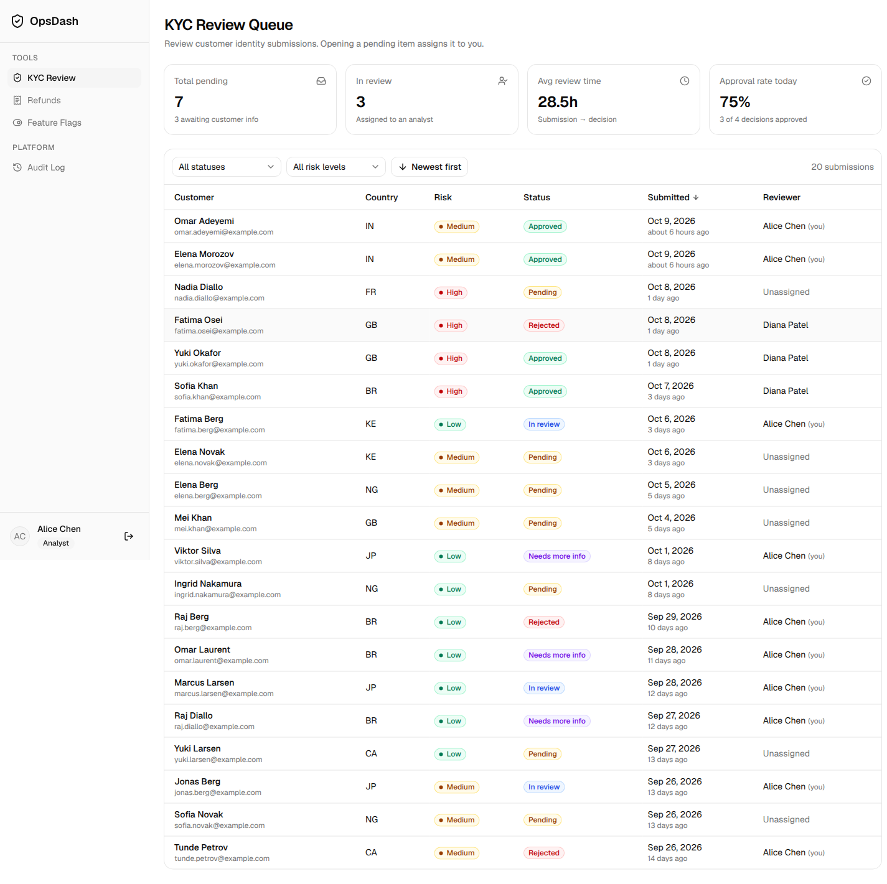
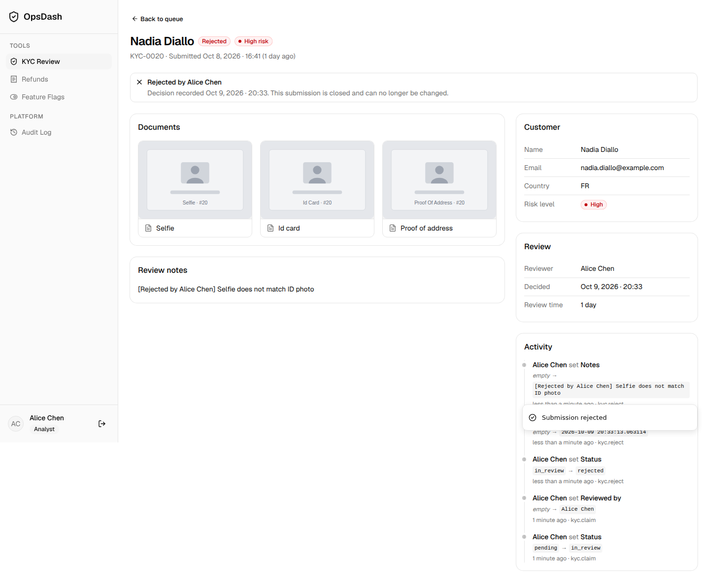
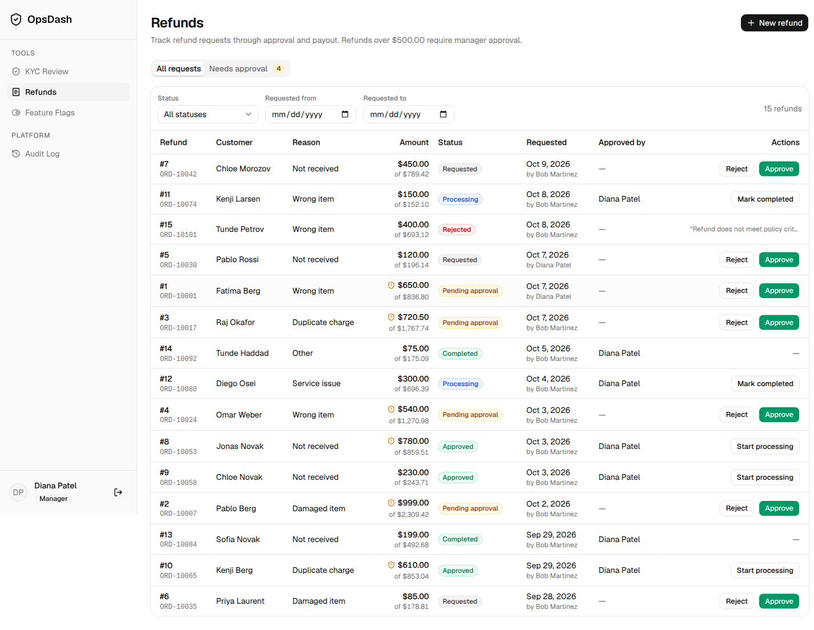
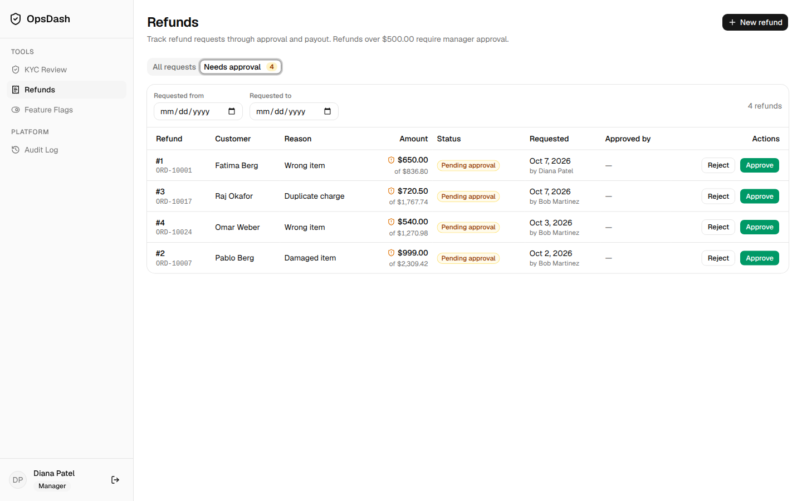
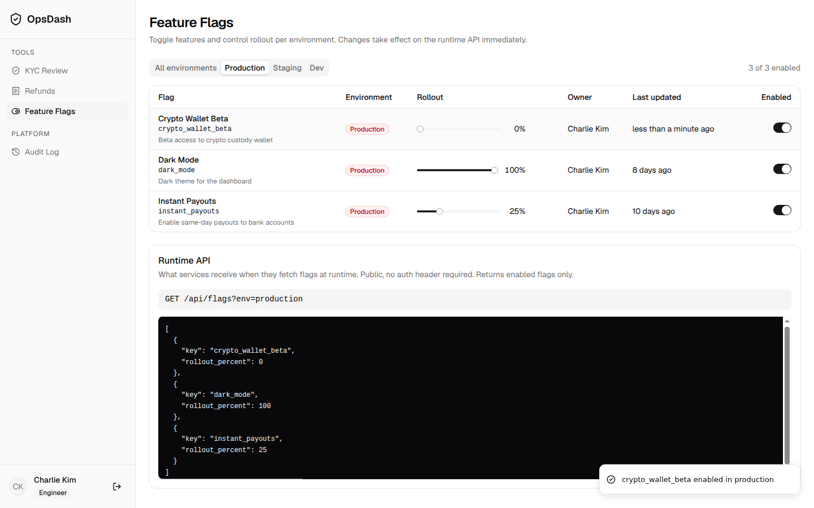
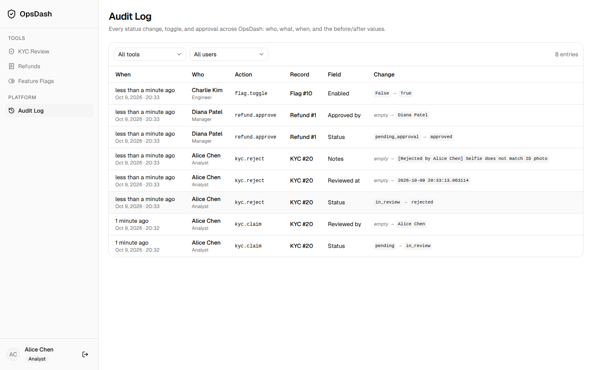

# OpsDash

> **Demo environment — synthetic data, simulated identity, no real payments.**
> OpsDash is a time-boxed prototype. It is not production-ready and must not be
> pointed at real customer data or payment systems.

OpsDash is an internal ops prototype for a fintech team. It has three tools
and a shared audit view, behind a simulated (mock) sign-in:

- **KYC Review**: a review queue for synthetic identity submissions. Analysts
  can claim a submission and approve it, reject it, or request more info.
- **Refunds**: refund intake, a manager-approval gate for amounts over $500,
  and a simulated processing → completed lifecycle.
- **Feature Flags**: an admin console for flag state and rollout percentages
  per environment, plus a public runtime read endpoint.
- **Audit Log**: application-written records of each mutation, one row per
  changed field.

## Running the demo

### 1. Backend (Python 3.10+, FastAPI + SQLite)

```bash
cd backend
python -m venv .venv
.venv/bin/pip install -r requirements.txt
.venv/bin/python seed.py      # FIRST RUN / RESET ONLY: see warning below
OPSDASH_MOCK_AUTH=1 .venv/bin/uvicorn app.main:app --reload --port 8000
```

`OPSDASH_MOCK_AUTH=1` is required. It explicitly opts in to simulated
identities (the `X-User-Id` header). If it is not set, the API **fails closed**:
every identity-dependent endpoint and `GET /api/users` return
`503` with a configuration error. There is no other authentication mode, and
OpsDash does not implement production authentication.
`GET /api/health` reports `"mock_auth": true|false`.

The database file is `backend/opsdash.db` by default. Override it with
`OPSDASH_DB_PATH`.

**Seed/reset is destructive.** `seed.py` drops and recreates all tables, then
loads deterministic synthetic data (4 users, 20 KYC submissions, 15 refunds,
10 flags). That deletes every change and audit row. Run it once to create the
demo database, or on purpose to reset it. It is not a normal startup step.

### 2. Frontend (Node 20/22, Vite + React + Tailwind + shadcn/ui)

```bash
cd frontend
npm install
npm run dev                   # http://localhost:5173
```

The dev server proxies `/api` to `http://localhost:8000`.

### 3. Checks

```bash
cd backend && .venv/bin/pytest -q          # API, refund-rule and auth-gate tests
cd frontend && npm run build && npm run lint
```

The tests run against a temporary SQLite DB seeded with `seed.seed()`, with
`OPSDASH_MOCK_AUTH=1` set by `tests/conftest.py`.

## What is implemented, simulated, and missing

### Implemented (enforced by the API, covered by tests)

- Role checks on every mutation (table below). The UI hides actions too, but
  the API is the enforcement point.
- KYC state machine: pending → in_review (auto-claim when an analyst opens
  the item) → approved / rejected (reason required) / needs_more_info.
  Terminal states return 409.
- Refund state machine:
  - `refund_amount <= $500.00`: created as `requested`. A support agent or
    manager can move it `requested → processing → completed`, with no manager
    approval and no `approved_by`.
  - `refund_amount > $500.00`: created as `pending_approval`. It cannot be
    processed until a **manager** approves it (`approved → processing →
    completed`). Support gets 403 on approve/reject.
  - Managers can reject `requested` or `pending_approval` refunds. Invalid or
    repeated transitions return 409, leave the state unchanged and write no
    audit rows.
- USD validation on refund creation. Amounts must be finite, > 0, have at
  most 2 decimal places, and be capped at max $1,000,000.00 per amount.
  Sub-cent values such as `0.001` are rejected (422), not rounded. The refund cannot exceed the `original_amount` supplied in the
  same request.
- Feature flags: toggle and rollout % (0–100) per environment.
  `GET /api/flags?env=` returns only enabled flags.
- Audit rows are written by `app/audit.py::write_audit` in the same DB
  transaction as the change they describe. Each row has actor (id, name,
  role), action, entity, field, previous value, new value and a UTC
  timestamp. No-op changes write nothing. Refund creation records the
  amount, original amount, order ID and reason.

### Simulated (looks real in the UI, but is not)

- **Identity**: the user picker sets `X-User-Id`, and anyone can claim any
  role. Only enabled with `OPSDASH_MOCK_AUTH=1`.
- **Refund payout**: "processing" and "completed" are status changes only.
  No money moves and no payment provider is called.
- **Original amount**: whatever the requester typed. It is not checked
  against any order or payment record.
- **KYC "Request more info"**: records a workflow action and changes status.
  No email or notification is sent.
- **KYC documents**: generated SVG placeholders, not real uploads.
- **Rollout %**: stored configuration returned by the runtime endpoint.
  OpsDash has no user-targeting or flag-evaluation engine.
- **Data**: all seeded people, emails, orders and amounts are synthetic.

### Production gaps (not built)

- Real authentication (SSO/OIDC), sessions, and server-side role assignment.
- Audit integrity. Audit rows are ordinary SQLite rows: the API has no
  endpoint to edit them, but anyone with DB file access can. There is no
  hashing, signing or external log shipping, so the log is not tamper-proof.
- Money stored as SQLite `REAL` (validated as 2-decimal `Decimal` at the
  API edge). A production system would use integer cents or `NUMERIC`.
- No idempotency keys, concurrency control (row locking or optimistic
  versions), migrations, rate limiting, pagination, PII handling or
  retention policy.
- No integrations: payment processor, KYC vendor, notifications, order system.

## Architecture

```
backend/
  app/
    main.py         FastAPI app, CORS, create_all on startup, /api/health
    db.py           engine/session, OPSDASH_DB_PATH
    models.py       users, kyc_submissions, refund_requests, feature_flags, audit_log
    schemas.py      pydantic request/response models (ISO-8601 UTC "Z" timestamps)
    auth.py         OPSDASH_MOCK_AUTH gate, X-User-Id dependency, require_roles
    audit.py        write_audit(): one audit row per changed field
    routers/        users, kyc, refunds, flags, audit, documents
  seed.py           destructive reset + deterministic synthetic data
  tests/            pytest + TestClient against a temp DB
frontend/
  src/lib/          api.ts (typed fetch, adds X-User-Id), format.ts
  src/types.ts      TS types mirroring backend schemas
  src/auth/         AuthContext (localStorage opsdash.userId) + permission map
  src/pages/        Login, KycQueue, KycDetail, Refunds, FeatureFlags, AuditLog
  src/components/   layout/AppLayout (sidebar + demo banner), shared
                    StatusBadge/PageHeader/ActionDialog/AuditTrail, ui/ (shadcn)
```

### Users and permissions (simulated)

| User          | Role           |
| ------------- | -------------- |
| Alice Chen    | analyst        |
| Bob Martinez  | support_agent  |
| Charlie Kim   | engineer       |
| Diana Patel   | manager        |

| Capability                         | Roles                  |
| ---------------------------------- | ---------------------- |
| Review KYC (approve/reject/info)   | analyst, manager       |
| Claim KYC (pending → in_review)    | analyst (others: no-op) |
| Create refund                      | support_agent, manager |
| Approve (> $500) / reject refund   | manager                |
| Process/complete refund            | support_agent, manager |
| Edit feature flags                 | engineer, manager      |

Public endpoints (no header needed): `GET /api/health`, `GET /api/flags`,
`GET /api/documents/*`. `GET /api/users` needs no header but returns 503 when
mock auth is disabled. Every other endpoint needs `X-User-Id`: missing or
unknown → 401, wrong role → 403.

### API endpoints

```
GET    /api/health
GET    /api/users
GET    /api/me
GET    /api/kyc?status=&risk_level=&sort=
GET    /api/kyc/stats
GET    /api/kyc/{id}
POST   /api/kyc/{id}/claim|approve|reject|request-info
GET    /api/refunds?status=&date_from=&date_to=&needs_approval=
POST   /api/refunds
POST   /api/refunds/{id}/approve|reject|process|complete
GET    /api/flags?env=production|staging|dev   (public runtime endpoint, enabled only)
GET    /api/feature-flags?environment=
PATCH  /api/feature-flags/{id}   {enabled?, rollout_percent?}
GET    /api/audit?entity_type=&entity_id=&user_id=&limit=
GET    /api/documents/{name}.svg        (generated placeholder images)
```

```bash
curl 'http://localhost:8000/api/flags?env=production'
```

## Screenshots

**Login** — Mock sign-in. Pick one of the four seeded users from a dropdown; a short role description appears under it. No passwords: the selected user ID goes in `localStorage` and is sent as `X-User-Id`.



**KYC Review queue** — Stat cards at the top: pending, in review, needs more info, average review time, approval rate today. Below them is a submissions table you can filter by status and risk level and sort by submitted date. It shows color-coded status and risk pills and the assigned reviewer.



**KYC detail** — Customer and review metadata, placeholder document thumbnails (click to preview full size), review notes, and an activity timeline built from the audit log. Analysts and managers get Approve, Reject (reason required), and Request More Info. When an analyst opens a pending item it is assigned to them automatically and moves to `in_review`. Terminal decisions are locked.



**Refunds dashboard** — All refund requests, with filters for status and requested-date range. Columns: order, amounts, reason, requester and approver. Support agents and managers can create refunds. Any refund over $500 goes to `pending_approval`.



**Refunds › Needs Approval** — The queue of refunds above $500. Only managers see Approve and Reject buttons; everyone else gets a read-only view.



**Feature Flags** — Flags with environment tabs (all/production/staging/dev). Engineers and managers get toggle switches and rollout-percent sliders; other roles see a read-only view. A live preview shows what `GET /api/flags?env=<env>` returns to services at runtime.



**Audit Log** — Every mutation across all tools: who (name + role), what (action, record, field), when, and the before/after values. Filter by tool and by user; record links go back to the item.


